# ⚡ Awesome Real-Time Ray Tracing & Retro Game Engines 🎮

  

  
  
  
  
  
  

---

## 🌟 Overview & SEO Meta Description 🚀

A comprehensive, curated repository and technical guide to **real-time ray tracing**, **hardware path tracing**, **retro game engines**, **RTX Remix mods**, and modern **WebGPU / WebGL 3D graphics rendering pipelines**. Discover top enterprise SaaS cloud rendering platforms alongside battle-tested open-source 3D engines, source ports (Doom, Quake, Duke Nukem 3D, Half-Life), and cutting-edge DXR/Vulkan ray tracing frameworks.

*Keywords: real-time ray tracing, path tracing, retro game engines, RTX Remix, Vulkan Ray Tracing, DXR, WebGPU, WebGL, 3D graphics, global illumination, BVH, Quake RTX, GZDoom, Godot, Three.js, Bevy.*

---

## 📑 Table of Contents
- [📊 Sector Overview & Market Dynamics](#-sector-overview--market-dynamics)
- [☁️ SaaS & Hosted Real-Time Rendering Platforms](#️-saas--hosted-real-time-rendering-platforms)
- [💻 Open-Source GitHub Projects](#-open-source-github-projects)
  - [🏆 Ranked Open-Source 3D Engines & Path-Traced Source Ports](#-ranked-open-source-3d-engines--path-traced-source-ports)
  - [🕹️ Essential Retro Source Ports & Ecosystem Runtimes](#️-essential-retro-source-ports--ecosystem-runtimes)
- [💖 Support & Sponsorship](#-support--sponsorship)
- [📈 Star History](#-star-history)
- [🤝 How to Contribute](#-how-to-contribute)
- [⚠️ Disclaimer](#️-disclaimer)

---

## 📊 Sector Overview & Market Dynamics 📈

The global real-time rendering, cloud graphics, and 3D simulation market is estimated at **$18.5 Billion in 2026**, projected to exceed **$35 Billion by 2030** with an accelerating compound annual growth rate (CAGR) of over 17.5%. 

The sector is **moderately concentrated** at the infrastructure and foundational hardware layers—dominated by tech giants like NVIDIA, Microsoft, and Amazon controlling cloud compute and GPU hardware pipelines—yet **highly fragmented and diversified** at the engine, modding, and tooling layer, where agile independent engines (Godot, Bevy, PlayCanvas) and vibrant open-source developer communities pioneer real-time path tracing, retro remasters, and WebGPU browser standardizations.

---

## ☁️ SaaS & Hosted Real-Time Rendering Platforms 🏢

*Ranked descending by Company Valuation / Enterprise Market Cap.*

| Platform / Service 🏷️ | Valuation / Revenue 💰 | Starting Tier Pricing 💳 | Free Tier Limit / Trial Duration 🎁 | Description 📝 |
| :--- | :--- | :--- | :--- | :--- |
| **[Amazon Nimble Studio / AWS G5/G6](https://aws.amazon.com/nimble-studio/)** | **~$2.1 Trillion** (Market Cap) | **$1.006/hr** (EC2 G5g GPU instances) / Pay-as-you-go | **12 Months Free Tier** (750 hours/mo micro instances + AWS Free Credit Credits) | Elastic cloud workstations and virtual rendering infrastructure powered by NVIDIA Tensor Core GPUs for real-time VFX, game engines, and virtual production. |
| **[NVIDIA RTX Cloud / GeForce NOW](https://www.nvidia.com/en-us/geforce-now/)** | **~$3.5 Trillion** (Market Cap) | **$9.99/mo** (Priority) / **$19.99/mo** (Ultimate 4K 240Hz RTX 4080) | **Free Forever Plan** (Standard access, basic rig, 1-hour session length limit) | Cloud-based GPU infrastructure delivering real-time RTX path tracing, full ray tracing, and DLSS frame generation directly to browsers and thin clients. |
| **[Babylon.js Hosted Tools (Microsoft)](https://babylonjs.com)** | **~$3.1 Trillion** (Market Cap) | **$0.00/mo** (100% Free Open Platform sponsored by Microsoft) | **Free Forever** (Unlimited shader builds, glTF inspection, WebGPU Sandbox exports) | Hosted web-based shader creation, Node Material Editor, and WebGPU inspection tools backed by Microsoft's real-time 3D web platform. |
| **[Three.js Online Editor](https://threejs.org/editor/)** | **Community / Open Non-Profit** | **$0.00/mo** (Completely Free & Open Source) | **Free Forever** (Unlimited scene authoring, client-side browser storage & GLTF/OBJ export) | Zero-install web-based 3D scene editor, material graph configurator, and real-time WebGL/WebGPU prototype staging studio. |
| **[Godot Web Editor](https://editor.godotengine.org/)** | **Community Foundation / Non-Profit** | **$0.00/mo** (Donation Supported) | **Free Forever** (Unlimited project creation, IndexedDB browser storage, WebAssembly export) | Official browser-based WebAssembly distribution of the Godot Engine, enabling instant 2D/3D development without local software installation. |
| **[Unreal Engine Pixel Streaming (Eagle 3D Streaming)](https://eagle3dstreaming.com)** | **~$50M - $100M** (Eagle 3D) / **~$22.5B** (Epic Games) | **$160/mo** (Starter tier including 100 streaming hours) | **7-Day Free Trial** (Includes 5 hours of dedicated NVIDIA GPU WebRTC streaming) | Ultra-low latency WebRTC streaming platform delivering real-time Lumen and hardware ray-traced Unreal Engine builds to mobile and desktop browsers. |
| **[Unity Cloud Hosting](https://unity.com/products/unity-cloud)** | **~$7.5 Billion** (Market Cap) | **$185/seat/mo** (Unity Pro required for custom cloud services) | **Free Forever Plan** (Unity Personal: 5 GB Cloud Storage, basic WebGL cloud builds for <$200k rev) | Managed cloud build pipelines, real-time asset hosting, and browser WebGL/WebGPU distribution services for interactive 3D Unity titles. |
| **[Chaos Vantage](https://www.chaos.com/vantage)** | **~$100M - $200M** (Chaos Group Est. Revenue) | **$43.90/mo** (or $329/year single license) | **30-Day Free Trial** (Full commercial functionality with zero watermarks for 30 days) | Standalone 100% ray-traced real-time viewport and live-link exploration engine capable of rendering massive production scenes at interactive 60+ FPS. |
| **[PlayCanvas Cloud Studio](https://playcanvas.com)** | **~$15M - $30M** (Snap Inc. Subsidiary) | **$15/user/mo** (Personal Plan for private projects) | **Free Forever Plan** (Unlimited public projects, 1 GB asset storage, full WebGPU/WebGL engine access) | Collaborative browser-native 3D game engine and visual editor offering zero-friction WebAssembly compilation and instant global URL publishing. |
| **[Wonderland Engine Cloud](https://wonderlandengine.com)** | **~$5M - $15M** (Early-Stage / Scale-Up) | **€49/user/mo** (Standard Developer License) | **Free Forever Plan** (Non-commercial indie tier with community support and watermarked builds) | Web-first high-performance 3D development platform optimized for 120 FPS WebAssembly, WebGPU, and WebXR browser applications. |

---

## 💻 Open-Source GitHub Projects 🛠️

### 🏆 Ranked Open-Source 3D Engines & Path-Traced Source Ports
*Sorted descending by GitHub Stargazer Count.*

- **[Godot Engine](https://github.com/godotengine/godot)**  🎮  
  Feature-packed multi-platform 2D and 3D game engine equipped with cutting-edge Vulkan, WebGPU, and OpenGL rendering backends, Signed Distance Field Global Illumination (SDFGI), and real-time volumetric fog.

- **[Three.js](https://github.com/mrdoob/three.js)**  🌐  
  The industry-standard JavaScript 3D engine powering the modern web with `WebGPURenderer`, node-based TSL shaders, compute shader pipelines, and real-time lighting.

- **[Bevy Engine](https://github.com/bevyengine/bevy)**  🦀  
  Ergonomic, data-driven game engine built from scratch in Rust, featuring a modular Entity Component System (ECS), `wgpu` rendering layer, and experimental `Solari` real-time global illumination.

- **[Raylib](https://github.com/raysan5/raylib)**  🕹️  
  Lightweight, dependency-free C game programming library loved for retro game prototyping, software renderers, and custom hardware shader development across desktop and WebAssembly.

- **[Babylon.js](https://github.com/BabylonJS/Babylon.js)**  🚀  
  High-performance real-time 3D engine backing production-grade WebGPU and WebGL graphics with physically based rendering (PBR), ray-traced shadows, and Havok physics.

- **[Google Filament](https://github.com/google/filament)**  📱  
  Cross-platform, real-time physically based rendering (PBR) engine developed by Google for mobile, desktop, and WebAssembly targeting Vulkan, Metal, and OpenGL.

- **[wgpu](https://github.com/gfx-rs/wgpu)**  ⚡  
  Pure Rust, cross-platform graphics library implementing the WebGPU standard across Vulkan, Metal, DirectX 12, and WebAssembly for native compute and ray tracing workloads.

- **[bgfx](https://github.com/bkaradzic/bgfx)**  🧩  
  Cross-platform, graphics-API-agnostic "Bring Your Own Engine/Framework" rendering library supporting Direct3D 11/12, Vulkan, Metal, OpenGL, and WebGPU.

- **[PlayCanvas Engine](https://github.com/playcanvas/engine)**  🏎️  
  Lightweight, lightning-fast WebGL 2 and WebGPU engine delivering 60+ FPS interactive 3D simulations and retro arcade games in desktop and mobile browsers.

- **[Wicked Engine](https://github.com/turanszkij/WickedEngine)**  🔮  
  Modern C++ game engine showcasing DirectX 12 and Vulkan hardware ray tracing, path tracing, voxel-based global illumination (VXGI), and real-time post-processing effects.

- **[NVIDIA Falcor](https://github.com/NVIDIAGameWorks/Falcor)**  🔬  
  NVIDIA's flagship open-source real-time research framework designed for rapid prototyping of DXR hardware ray tracing, neural radiance caching, and path tracing.

- **[GZDoom](https://github.com/ZDoom/gzdoom)**  👹  
  The modern standard source port for *Doom*, *Heretic*, and *Hexen*, featuring OpenGL/Vulkan hardware rendering, dynamic sector lighting, PBR materials, and 3D floors.

- **[Selkies Streaming](https://github.com/selkies-project/selkies)**  📡  
  Open-source WebRTC cloud gaming and GPU desktop streaming platform for self-hosting low-latency interactive 3D applications directly in any modern browser.

- **[Chocolate Doom](https://github.com/chocolate-doom/chocolate-doom)**  🍫  
  Historically accurate, minimalist source port preserving classic 1990s id Tech 1 DOS engine behavior, serving as the clean reference baseline for retro engine hackers.

- **[vkQuake](https://github.com/Novum/vkQuake)**  🌋  
  Vulkan-based source port of original *Quake* (id Tech 2 precursor) featuring modern multithreaded command buffers, crisp water warping, and high refresh rate support.

- **[three-gpu-pathtracer](https://github.com/gkjohnson/three-gpu-pathtracer)**  ✨  
  Progressive real-time path tracing engine for Three.js utilizing BVH spatial acceleration structures to deliver photorealistic physical lighting directly in browser viewports.

- **[NVIDIA RTX Remix](https://github.com/NVIDIAGameWorks/rtx-remix)**  🛠️  
  Open-source runtime, DX8/9 interception layer, and toolkit enabling creators to capture classic PC game assets and inject full hardware path tracing, PBR, and DLSS.

- **[Quake II RTX (Q2RTX)](https://github.com/NVIDIA/Q2RTX)**  🔫  
  NVIDIA's fully path-traced pure Vulkan renderer for *Quake II*, implementing real-time global illumination, indirect reflections, refractions, and volumetric sunlight.

- **[Half-Life 1 Ray Traced (Xash3D-FWGS RT)](https://github.com/sultim-t/xash-rt)**  ☢️  
  Hardware path tracing fork of the open-source Xash3D FWGS engine by Sultim Tsyrendashiev, introducing real-time ray-traced lighting and reflections to the original *Half-Life*.

- **[Yamagi Quake II](https://github.com/yquake2/yquake2)**  🛸  
  Enhanced, rock-solid alternative Quake II client focusing on bug fixes, modern OS compatibility, and modern OpenGL 3.2 / Vulkan renderer support.

- **[Doom Ray Traced (PrBoom-Plus RT)](https://github.com/sultim-t/prboom-plus-rt)**  💥  
  Full hardware path-tracing port of classic *Doom* built upon PrBoom-Plus, adding dynamic global illumination, emissive weapon projectiles, and physically grounded shadows.

- **[Duke-RT](https://github.com/postmemetic/Duke-RT)**  🕶️  
  Path-traced hardware renderer for Ken Silverman's classic Build Engine (*Duke Nukem 3D*), bringing dynamic point lights, indirect illumination, and reflective surfaces to 2.5D retro sectors.

- **[Serious Sam Ray Traced](https://github.com/sultim-t/Serious-Engine-RT)**  💣  
  Real-time Vulkan hardware ray tracing integration into Croteam's Serious Engine v1.10, featuring full path tracing across *Serious Sam: The First Encounter*.

---

### 🕹️ Essential Retro Source Ports & Ecosystem Runtimes ⚙️

- **[EDuke32](https://voidpoint.io)** 🌆 — The premier Build Engine source port powering *Duke Nukem 3D* and *Ion Fury* with advanced Polymost/Polymer 3D renderers and scriptable CON extensions.
- **[QuakeSpasm](https://quakespasm.sourceforge.net/)** ⚡ — Clean, faithful Quake engine source port based on FitzQuake with support for modern widescreen resolutions, 64-bit systems, and extended engine limits.
- **[DSDA-Doom](https://github.com/kraflab/dsda-doom)** ⏱️ — Highly optimized speedrunning-focused Doom source port providing strict compatibility verification and advanced demo recording features.
- **[Dawn (Google)](https://dawn.googlesource.com/dawn)** 🌐 — Google's reference open-source C++ implementation of the WebGPU API, powering Chrome's real-time WebGPU browser rendering pipeline.

---

## 💖 Support & Sponsorship 🙏

If you find this curated collection of real-time ray tracing projects and retro game engines helpful, please consider starring ⭐, forking 🍴, and sharing 📢 this repository with other graphics programmers and modders!

Your support helps maintain active updates and research into retro engine ray-tracing breakthroughs.

Thank you to all community contributors, graphics researchers, and retro source-port authors for keeping classic gaming tech alive and visually stunning!

---

## 📈 Star History

---

## 🤝 How to Contribute 💡

1. 🍴 **Fork the repository**.
2. 🌿 **Create a descriptive feature branch** (`git checkout -b feature/add-new-rt-engine`).
3. 📝 **Add or update entries** in `README.md` keeping formatting consistent with tables or badge rankings.
4. 🔍 **Verify links and star badges** point directly to the project's stargazers or official website.
5. 🚀 **Submit a Pull Request** with a concise description of the new engine or mod.

---

## ⚠️ Disclaimer 📜

- This repository is an independent **community-curated directory** and does not constitute an official endorsement by any hardware vendor or engine developer.
- Classic game source ports and RTX Remix remaster mods require legally acquired original game data files (`.wad`, `.pak`, `.grp`, or licensed base games) to operate.
- Real-time hardware path tracing demands modern GPU hardware supporting Vulkan Ray Tracing (`VK_KHR_ray_tracing_pipeline`), DirectX Raytracing (DXR tier 1.0/1.1), or WebGPU compute capabilities.

---

  <b>Built with ❤️ for graphics engineers, retro gaming preservationists, and WebGPU pioneers worldwide.</b>

